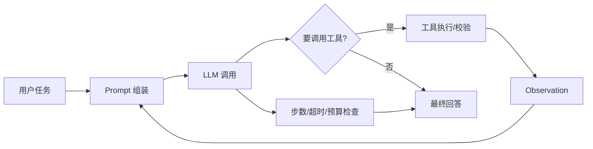
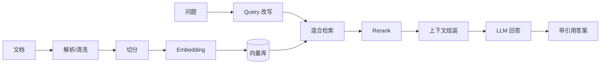
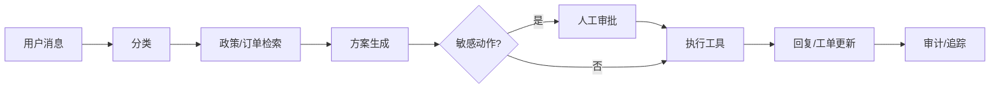

# Agent 开发学习路线（2026-11 → 2027-05）

> 适用对象：会 Python、还没做过 LLM 应用，每周能投入 10–20 小时，目标是中国市场的 Agent 应用开发岗。
>
> 路线周期：24 周，2026-11-30 ~ 2027-05-16，按每周 12–15 小时设计。
>
> 使用方式：先读第 0 节了解全局，再用第 3 节按周执行；具体到“每周学什么、产出什么”，直接看 **3.6 逐周学习与产出清单**。每完成一周，在 `学习进度追踪.md` 里打勾并写 5 行复盘。不要从头到尾“学完再动手”，每个阶段都必须有可运行产出。
>
> 本机环境检查结果：[环境自检报告.md](<环境自检报告.md>)（2026-11-24）。

---

## 0. 一页纸总览

### 0.1 目标岗位

主攻 **LLM 应用开发工程师 / Agent 开发工程师**，备选 **Agent 平台与基础设施**、**AI 应用工程师**、**FDE/交付工程师**。不把“大模型算法研究”作为 24 周目标。

### 0.2 路线图

| 阶段 | 周次 | 时间 | 主题 | 里程碑 |
|---|---|---|---|---|
| P0 地基 | W1–W4 | 2026-11-30 ~ 12-27 | Python 工程化、LLM API、提示词/上下文、从零实现 Agent | M0：无框架 Agent + 20 例评测 |
| P1 RAG | W5–W9 | 2026-12-28 ~ 2027-01-31 | 文档解析、检索、rerank、引用、RAG 评测、服务化 | M1：知识库服务 + 50 题评测 |
| P2 Agent + MCP | W10–W16 | 2027-02-01 ~ 03-21 | LangGraph、状态/记忆、HITL、MCP、工具安全、追踪 | M2：客服 Agent v1 |
| P3 工程化 | W17–W20 | 2027-03-22 ~ 04-18 | 异步/队列/缓存、评测 CI、可观测、红队、部署 | M3：可上线 + 作品集 |
| P4 求职 | W21–W24 | 2027-04-19 ~ 05-16 | 简历、系统设计、投递、模拟面试、复盘 | M4：求职冲刺完成 |

### 0.3 三个作品集项目

1. **`agent-from-scratch`**：不用框架，从零实现 ReAct Agent，证明你懂循环、工具、错误处理和评测。
2. **`rag-knowledge-base`**：企业知识库问答，混合检索 + rerank + 引用 + 50 题评测 + Docker。
3. **`support-agent`**：LangGraph + MCP + 策略 RAG + 人工审批的客服工单 Agent，带追踪、审计、红队测试。

### 0.4 每周节奏（13 小时版）

| 时间 | 时长 | 内容 |
|---|---|---|
| 周一 21:00–23:00 | 2h | 读概念 + 写最小示例 |
| 周三 21:00–23:00 | 2h | 编码/修 bug |
| 周六 09:00–12:00、14:00–16:00 | 5h | 项目主攻 |
| 周日 09:00–12:00 | 3h | 项目 + 测试 |
| 周日 20:00–21:00 | 1h | 写复盘/文章 |

如果只能 10 小时：砍掉周三（-2h）、周六少 1 小时（-1h），约 10 小时；如果能 20 小时：加两个工作日晚上和一个周末半天。

### 0.5 成功标准

- 3 个项目都有 README、架构图、测试、评测报告、成本/延迟数据；至少 1 个有 3 分钟演示。
- 至少 1 个 MCP Server 被真实客户端调用；至少 1 个项目可公网演示或一条命令本地启动。
- 3 篇技术复盘；1 页简历；30–50 份精准投递；5 次模拟面试；10 道系统设计题。
- 自测能回答 80% 的核心面试题，能白板画出 Agent/RAG 架构并讲清取舍。
- **诚实预期**：这是“达到可面试、可交付”的路线，不承诺一定拿 offer；结果还取决于市场、学历、过往经历和运气。

### 0.6 明确不学

- 不训练/微调大模型，不碰 RLHF、RL、CUDA、vLLM 内核；只到“能解释、知道何时用”的 L1。
- 不手写向量索引、不追多智能体框架全家桶、不刷 500 道 LeetCode、不囤 20 门课。
- 不追求“全自动 Agent”而跳过人工审批、评测和安全边界。

---

## 1. 目标与岗位地图

### 1.1 你要投的岗位

| 岗位 | 核心交付 | 与你路线的匹配度 | 备注 |
|---|---|---|---|
| LLM 应用开发工程师 / Agent 开发工程师 | 能上线的 RAG、工具调用、工作流、评测 | **主攻** | 岗位最多，重视 Python + 框架 + 落地 |
| AI 应用工程师 / AI 产品工程师 | 从需求到 Demo 到上线，可能带前端 | 相邻 | 需要补产品感和简单前端 |
| Agent 平台 / AI Infra 工程师 | 多租户、沙箱、队列、评测平台、可观测 | 备选 | 通常要求后端经验，24 周只能到入门 |
| FDE / 交付工程师 | 驻客户部署、MCP Server、方案交付 | 相邻 | 沟通和出差要求高，技术侧重交付而不是平台 |
| 大模型算法工程师 | 预训练/后训练、论文、Benchmark | 不匹配 | 多数要求硕博/顶会/竞赛，短期不建议 |

### 1.2 市场信号（2026）

- 2026 年 5 月的 JD 调研显示，中型厂和传统 IT/SaaS 对“AI Agent 工程师 / LLM 应用开发工程师”的硬性要求高度趋同：**Python + LangChain/LangGraph + RAG + Tool Calling + 向量库 + Docker/K8s**。
- 同一份调研里，**MCP 的出现率约 16.9%，被称为 2026 年增速最快的单一技能**；独立 Prompt 工程师岗位在萎缩，能力被“Agent 应用工程师”和“上下文工程”吸收。
- 2026 年下半年，**Agent Skills、Harness（Agent 运行时）**开始出现在部分 JD 和面试里（社区观察，非严谨统计）；它们更像加分项，先把 RAG、Agent 循环、评测打牢，再选学。
- MCP 规范在 **2026-07-28** 发布了新版本，核心变化包括移除协议级 session、强化授权、扩展机制调整。学习时以官方最新规范为准，旧教程里的 session 细节可能已经过时。
- 薪资数据只作方向参考：不同城市、公司、级别的差异很大，不要用单一数字给自己设限或抬价。

> 参考：[AI Agent 岗位 JD 调研（2026-05）](https://github.com/harrisliangsu/ai-agent-engineer-handbook/blob/main/interview-prep/jd-requirements.md)、[MCP 规范 2026-07-28](https://modelcontextprotocol.io/specification/2026-07-28/index)。

### 1.3 24 周后你要能做到

1. 把模糊需求拆成 **workflow 或 agent**，画出状态图，定义成功指标和失败边界。
2. 不用框架从零实现 Agent 循环；也能用 LangGraph 落地有状态、可中断、可恢复的流程。
3. 搭一套能用的 RAG：解析、切分、混合检索、rerank、引用、增量更新，并用指标证明它变好了。
4. 写 MCP Server/Client，把真实工具接进 Agent，理解权限、传输和安全边界。
5. 做评测、追踪、成本/延迟分析，能定位“是检索错了、工具选错了，还是模型编了”。
6. 用 FastAPI + Docker 部署，写 runbook，做基本的限流、缓存、幂等和人工审批。
7. 把项目讲成“问题 → 方案 → 指标 → 取舍 → 复盘”，而不是“我用了什么框架”。

---

## 2. 能力矩阵与深度标准

### 2.1 五级深度

| 等级 | 标准 | 判断方式 |
|---|---|---|
| L0 | 听说过，能说名词 | 能解释概念，但没写过 |
| L1 | 能跑通 demo，能改示例 | 跟着文档能跑，离开文档就卡 |
| L2 | 能独立从零做出来，能排错 | 不给代码也能搭，遇到报错能定位 |
| L3 | 能设计架构、解释权衡、用评测证明有效 | 能回答“为什么这样选”，能拿数据说服人 |
| L4 | 能优化成本/性能/可靠性，能分享与带人 | 能做对比实验、写规范、教别人 |

**目标**：核心能力到 **L3**，框架到 **L2–L3**，平台/基础设施到 **L2**，研究到 **L0–L1**。面试里最容易被追问的是“你为什么不用更简单的方案”，所以 L3 的重点是**取舍**，不是背 API。

### 2.2 技能矩阵

| # | 技能 | 具体内容 | 目标 | 验收证据 | 对应周 |
|---|---|---|---|---|---|
| 1 | Python 工程化 | typing、Pydantic、async、pytest、Ruff、FastAPI、SQL、Git | L3 | 一个有测试、有 CI、有类型标注的服务 | W1–W4、W9、W17 |
| 2 | LLM API 与上下文工程 | token、上下文窗口、temperature/top_p、结构化输出、流式、Function Calling、成本/延迟 | L3 | 20 例提示词评测 + 成本对比表 | W1–W2、W4 |
| 3 | RAG | 解析、切分、embedding、向量库、混合检索、rerank、query rewrite、引用、增量更新 | L3 | 50 题 golden set + recall/faithfulness 报告 | W5–W9 |
| 4 | Agent 核心 | ReAct、plan-execute、记忆、状态、最大步数、超时/重试、HITL、guardrails | L3 | 从零实现的 Agent + 失败分类 | W3–W4、W11–W15 |
| 5 | LangGraph | State、Node、Edge、条件分支、checkpointer、interrupt、subgraph | L2–L3 | 可中断/恢复的有状态图 | W10–W12 |
| 6 | MCP | 协议、Server/Client、tools/resources/prompts、stdio/Streamable HTTP、授权、安全 | L2–L3 | 自己的 MCP Server + 真实客户端调用 | W13–W14 |
| 7 | 评测与可观测 | 三层评测、golden set、LLM-as-judge、回归门禁、trace、成本/延迟 | L3 | CI 评测门禁 + Langfuse 面板 | W8、W16、W18–W19 |
| 8 | 工程化与部署 | 异步、队列、Redis、缓存、限流、Docker、Postgres/pgvector、K8s 基础 | L2–L3 | 一条命令启动 + 压测/成本报告 | W9、W17、W20 |
| 9 | 安全与可靠性 | prompt injection、越权、PII、密钥、沙箱、最小权限、幂等、审计 | L2–L3 | 红队测试报告 + 权限矩阵 | W15、W19 |
| 10 | 多智能体 | supervisor、handoff、subgraph、何时不用多 Agent | L2 | 一个 supervisor 示例 + 取舍说明 | W12、选学 |
| 11 | 产品/业务 | 需求拆解、成功指标、交互与人工兜底 | L2 | 一页 PRD + 上线指标 | W20–W21 |
| 12 | 求职表达 | 简历、项目叙事、系统设计、行为面试 | L3 | 1 页简历 + 5 次 mock + 10 道设计题 | W21–W24 |
| 13 | AI 辅助编程 | 用 Cursor/Claude Code/DSH 完成模块，能 review、测试、解释 | L2 | 一个由 AI 辅助完成但你能讲清的模块 | W1–W20 |

> 说明：K8s 只需要会写 Deployment/Service、懂资源限制和滚动更新；不要求搭集群、调网络插件。向量库只需要懂索引类型和取舍，不要求手写 HNSW。

### 2.3 必须能讲清楚的概念

**LLM 基础**
- token、上下文窗口、temperature/top_p、停止条件
- 结构化输出与 JSON Schema、Function Calling 的协议流程
- 幻觉的成因、为什么 RAG 不能消除幻觉
- 上下文工程：系统提示、工具描述、检索内容、历史对话如何争抢窗口
- 成本与延迟：输入/输出 token、缓存、批处理、模型分级

**RAG**
- 切分策略：固定长度、语义、按标题/段落；chunk size 与 overlap 的取舍
- embedding 模型选择、向量相似度、索引类型（HNSW/IVF）的粗略取舍
- 混合检索：BM25 + 向量；为什么需要 rerank
- query rewrite / multi-query / HyDE 的适用场景
- 引用与可追溯：如何让答案落到具体文档和段落
- 指标：recall@k、MRR、context precision、faithfulness、answer relevance

**Agent**
- workflow 与 agent 的边界：什么时候用固定流程，什么时候让模型决策
- ReAct 循环：thought → action → observation → 停止条件
- 工具设计（ACI）：命名、描述、参数、错误信息、幂等
- 记忆：短期对话、长期偏好、任务状态；什么时候摘要，什么时候检索
- HITL：哪些动作必须人工确认；中断、恢复、超时
- 失败模式：死循环、工具选错、参数错、上下文污染、过早结束
- 多 Agent：supervisor/handoff 的收益与协调成本；为什么多数场景单 Agent + 工具就够
- MCP 与 Function Calling 的区别：协议层、复用、权限、生态
- Harness 与 Skills：模型之外的循环调度、工具注册、上下文压缩、断点恢复、沙箱；Skill 与 MCP/Function Calling 的边界

**工程**
- 异步与并发、队列、重试、幂等、限流、缓存
- 评测集、回归门禁、trace、成本核算
- 安全：prompt injection、工具越权、数据泄露、沙箱
- 部署：容器、健康检查、日志、告警、runbook

### 2.4 不学什么（范围控制）

- 不学预训练/后训练的具体训练技巧；只需知道 SFT/LoRA/RLHF 大概是什么、什么时候不该用。
- 不学 CUDA、推理引擎内核、分布式训练；这些是算法/Infra 岗，不是应用岗的主战场。
- 不手写向量数据库；理解原理 + 会用 pgvector/Chroma 即可。
- 不追所有 Agent 框架；LangGraph 为主，OpenAI Agents SDK 对照，Dify/Coze 只做常识了解。
- 不刷大量算法题；应用岗的编码门槛通常低于算法岗，重点是把业务代码写对。

---

## 3. 24 周计划

### 3.0 日历、节奏与弹性

- **开始**：2026-11-30（周一）；**结束**：2027-05-16（周日）。
- **第 0 周（现在–11/29）**：装 Python/uv/Git/Docker，开通至少一家模型 API，建 GitHub 仓库，读本路线，写下半年的目标。
- **每周 12–15 小时**：70% 写代码，20% 读文档/文章，10% 写复盘。
- **春节**：2027-02-05 ~ 02-13 放假，覆盖 W10–W11；W10 按 6–8 小时最低维护量，W11 计划 13 小时但可按 6–10 小时执行，差额用 W23 缓冲吸收，W12 恢复正常节奏。
- **劳动节**：2027-05-01 在 W22，投递和 mock 继续，但降低新知识输入。
- **缓冲**：W10 和 W23 是缓冲周；落后时优先用它们吸收，不压缩评测和部署。

**顺序理由**：不会调 API 就学 RAG，容易变成拼配置；不懂 Agent 循环就上 LangGraph，容易变成背 API；没有评测就做工程化，不知道优化什么。每个阶段都依赖前一层，所以不要跳。

**每周固定动作**
1. 周一写 3 条本周目标（可验收）。
2. 周三检查是否有一半时间在写代码；如果一直在看视频，立刻停。
3. 周六做项目主攻，周日补测试和文档。
4. 周日写 5 行复盘：交付、指标、失败、下周砍什么、实际时长。
5. 每周至少 1 次 commit + 1 条技术笔记。
6. 在第 9、16、20 周各把一篇周复盘整理成公开文章，正好 3 篇。

### 3.1 P0 地基（W1–W4）

**目标**：不依赖框架，理解 LLM 调用、结构化输出、工具调用和 Agent 循环；建立“评测先行”的习惯。

| 周 | 重点 | 具体任务 | 交付 |
|---|---|---|---|
| W1 | 环境与 API | 装 Python 3.11+、uv、Git、Docker；跑通 2–3 家 OpenAI 兼容 API；比较 token 价格、延迟、中文能力 | `notes/api-baseline.md`：3 家模型对比 |
| W2 | 结构化输出与工具 | Pydantic + JSON Schema；流式输出；Function Calling 的请求/响应结构；写一个 CLI 聊天 | `cli-chat`：支持流式 + 一个工具 |
| W3 | 从零实现 Agent | 工具注册表、ReAct 循环、最大步数、超时、重试、结构化日志；3 个工具（如时间、SQLite 查询、文件读取） | `agent-from-scratch` v0.1 |
| W4 | 评测与重构 | 20 个任务用例；记录成功率、步数、成本；补单测；画架构图；写 README | 项目 A 完成，**M0** |

**必学**
- Chat Completions / Responses API 的基本结构；消息角色；流式事件。
- JSON Schema、Pydantic 校验、失败重试；工具参数的边界。
- ReAct 的基本循环和停止条件；为什么要最大步数。
- 提示词/上下文工程：指令、示例、工具描述、输出约束。
- pytest、logging、环境变量与密钥管理。

**做到什么程度**
- 能不看教程写出一个带 3 个工具、能处理工具报错、不会无限循环的 Agent。
- 能解释“为什么这里不用 LangGraph”。
- 能拿出 20 例评测，说明成功率和主要失败类型。

**常见坑**
- 一上来装 LangChain，结果只会拼 API，不知道底层发生了什么。
- 工具描述写得太随意，模型选错工具；要学会像写文档一样写工具。
- 没有最大步数和超时，跑飞了还不知道。
- 只看成功率，不看步数、成本和失败类型。

### 3.2 P1 RAG（W5–W9）

**目标**：搭一套可评测、可引用、可部署的知识库问答；理解“检索质量决定上限”。

| 周 | 重点 | 具体任务 | 交付 |
|---|---|---|---|
| W5 | 解析与切分 | PDF/Markdown/HTML 解析；按标题/段落切分；chunk size/overlap 实验；Chroma 建库 | 100+ 文档可检索 |
| W6 | 检索增强 | BM25 + 向量混合；rerank；query rewrite；metadata filter | 检索对比报告（3 组方案） |
| W7 | 回答与引用 | 组装上下文；要求引用；无答案时拒答；多轮改写；增量更新 | 带 citation 的问答 demo |
| W8 | 评测 | 50 题 golden set；recall@5、context precision、faithfulness、answer relevance；错误分类 | 评测报告 v1 |
| W9 | 服务化 | FastAPI 接口；Streamlit/Gradio；Docker Compose；README/架构图 | 项目 B 完成，**M1**；复盘文章 1 |

**必学**
- 文档解析的脏数据处理：页眉页脚、表格、扫描件、重复内容。
- 切分的取舍：太小丢上下文，太大引入噪声；按结构切通常优于固定长度。
- embedding 与向量库：Chroma 本地、pgvector 部署；索引参数只学到“知道影响”。
- 混合检索与 rerank：为什么向量检索会漏关键词，BM25 补什么。
- 引用：返回 chunk id、文档、页码/段落；让用户能点回去。
- RAG 指标：检索指标和生成指标分开看；LLM-as-judge 要抽样人工校准。

**做到什么程度**
- 能解释“答错了”是检索没召回、rerank 排错、上下文太长、还是模型没按要求引用。
- 能拿 50 题评测说明某次改动让 recall 或 faithfulness 变好/变差。
- 能一条命令启动服务，换一台机器也能跑。

**常见坑**
- 只调 prompt，不测检索；检索错了，prompt 再漂亮也没用。
- 用“感觉不错”代替评测；没有 golden set 就没有进步。
- chunk 太大导致上下文污染；引用指向整篇文档而不是具体段落。
- 把“模型说不知道”当成失败；没有答案时拒答是正确行为。

### 3.3 P2 Agent 核心与 MCP（W10–W16）

**目标**：用 LangGraph 做有状态、可中断、可恢复的 Agent；用 MCP 接真实工具；建立安全边界和追踪。

| 周 | 重点 | 具体任务 | 交付 |
|---|---|---|---|
| W10 | LangGraph 基础 | State、Node、Edge、条件分支；把项目 A 的循环重写成图 | `langgraph-agent` v0.1（春节低强度） |
| W11 | 状态与 HITL | checkpointer、持久化、interrupt、恢复、超时 | 可中断/恢复的会话 |
| W12 | 记忆与多轮 | 短期对话、长期偏好、摘要压缩；subgraph；supervisor 概念 | 记忆策略对比 + supervisor 示例 |
| W13 | MCP Server | 协议基础；tools/resources/prompts；stdio；写 3 个工具 | 自己的 MCP Server |
| W14 | MCP Client 与安全 | Streamable HTTP；接入 LangGraph/OpenAI Agents SDK/桌面客户端；授权与权限 | 真实客户端调用 + 权限矩阵 |
| W15 | 工具安全 | 工具设计/ACI；沙箱；guardrails；prompt injection/越权测试 | 红队测试报告 |
| W16 | 项目 C 集成 | 客服工单流程；策略 RAG；人工审批；Langfuse 追踪；演示 | 项目 C v1，**M2**；复盘文章 2 |

**必学**
- LangGraph 的核心：状态如何流转、检查点如何持久化、interrupt 如何恢复。
- HITL 的设计：哪些动作必须确认、如何展示证据、超时怎么办、如何审计。
- MCP 的架构：Host/Client/Server；tools/resources/prompts 的区别；stdio 与 Streamable HTTP 的适用场景。
- 2026-07-28 规范的变化：不要照抄旧教程的 session 机制；以官方 spec 和 changelog 为准。
- 工具安全：最小权限、参数校验、沙箱、幂等、审计日志；prompt injection 如何通过工具和检索内容进入系统。
- 多 Agent 的取舍：supervisor/handoff 适合什么，为什么多数业务单 Agent + 工具更稳。

**做到什么程度**
- 能画出一个有状态 Agent 图，解释每个节点、边、检查点和中断点。
- 能写一个 MCP Server，让至少一个真实客户端（LangGraph、OpenAI Agents SDK、Claude Desktop、DSH 等）调用。
- 能列出工具权限矩阵，说明哪些动作只读、哪些需要审批、哪些禁止。
- 能用 trace 定位一次失败：哪一步、哪个工具、多少 token、错在哪。

**常见坑**
- 把 LangGraph 当 LangChain 用，只包一层 API，没用到状态和中断。
- MCP 只跑官方 echo demo，没有接真实数据/工具。
- 给 Agent 过高权限（写文件、发邮件、退款）却没有审批和沙箱。
- 多 Agent 看起来酷，但协调成本和延迟翻倍；没有评测就不要上。

### 3.4 P3 工程化（W17–W20）

**目标**：把项目 C 从“能演示”做到“能上线”：并发、成本、评测门禁、可观测、安全、部署。

| 周 | 重点 | 具体任务 | 交付 |
|---|---|---|---|
| W17 | 生产架构 | 异步、队列、Redis 缓存、限流、Postgres、成本预算；压测 | 压测与成本报告 |
| W18 | 评测 CI | 把 golden set 接进 pytest + DeepEval（或 RAGAS）；prompt 版本；回归门禁 | CI 评测门禁 |
| W19 | 可观测与安全 | Langfuse trace、dashboard、告警；红队、PII、密钥、审计 | Dashboard + 红队报告 |
| W20 | 部署与作品集 | Docker Compose/云部署；runbook；README/演示视频；简历素材 | 项目 C 上线/一键部署，**M3**；复盘文章 3 |

**必学**
- FastAPI 异步、后台任务、队列；什么任务适合异步，什么必须同步。
- Redis 缓存与限流；幂等键；重试与死信。
- 评测 CI：每次改 prompt/模型/检索参数都跑回归；阈值怎么定。
- 可观测：trace 里至少记录 prompt 版本、模型、token、成本、工具调用、延迟、错误。
- 安全：prompt injection、工具越权、PII、密钥、日志脱敏；红队用例。
- 部署：容器、健康检查、环境变量、日志、回滚、runbook。

**做到什么程度**
- 能说清楚 p95 延迟、单次成本、失败率、危险动作率。
- 能拿一次回归报告说明“这次改动为什么不能上线”。
- 能在新机器上按 README 一条命令启动；有 runbook 处理常见故障。

**常见坑**
- 只做 Demo，不做并发和成本；一上量就崩。
- 评测集和线上分布不一致；只测“顺利路径”。
- 日志里打印密钥/PII；工具没有最小权限。
- 部署靠“我这能跑”，没有环境变量和健康检查。

### 3.5 P4 求职（W21–W24）

**目标**：把项目转成简历和面试表达；用投递反馈修正学习，而不是等“全部学完”。

| 周 | 重点 | 具体任务 | 交付 |
|---|---|---|---|
| W21 | 简历与作品集 | 1 页简历；3 个项目 README；项目叙事（问题→方案→指标→取舍）；JD 关键词映射；首轮 5–10 份投递 | 简历 v1 + 作品集 + 首轮投递 |
| W22 | 系统设计与八股 | 10 道 Agent/RAG 系统设计；核心八股；Python/SQL 编码；2 次 mock | 设计题笔记 + mock 反馈 |
| W23 | 投递与补弱 | 补足累计 30–50 份精准投递；内推；累计 5 次 mock；按面试反馈补 1–2 个缺口 | 投递记录 + 补弱清单 |
| W24 | 面试与复盘 | 面试复盘；谈薪；90 天后续计划；把新问题写回题库 | 复盘 + 下一步计划，**M4** |

**必学**
- 简历公式：**问题 → 方案 → 指标 → 取舍**。不要写“精通 LangChain”。
- 项目叙事：2 分钟版、5 分钟版、深挖版；每个项目准备 3 个失败案例。
- 系统设计：需求澄清、数据流、组件、状态、评测、成本、失败模式。
- 行为面试：为什么转 Agent、如何学习、如何协作、遇到的最大失败。
- 谈薪：先研究范围，不先报数字；关注团队、mentor、数据、成长。

**做到什么程度**
- 能在 2 分钟内讲清一个项目，在 10 分钟内接受深挖。
- 能白板画出一个 Agent 系统，标出评测点、人工审批点、失败兜底。
- 能诚实说明“这个方案我没做过，但我会这样验证”。

### 3.6 逐周学习与产出清单

> 这一节是执行清单；上面的阶段表是概览。每周日把“产出”写进 `学习进度追踪.md`，并对照“完成标准”打勾。产出尽量提交到 GitHub，哪怕很小。

#### P0 地基（W0–W4）

**W0（现在–11/29）｜准备**
- 学什么：装 Python 3.11+、uv、Git、Docker；选 1–2 家模型 API；读本路线；确定目标岗位。
- 产出：可用的开发环境；GitHub 仓库；`notes/kickoff.md`（目标、时间、预算、约束）。
- 完成标准：能用 Python 发一次 API 请求；密钥放在 `.env`，没有提交到 Git。

**W1（11/30–12/06）｜API 与成本基线**
- 学什么：OpenAI 兼容接口、消息角色、token 计费、temperature/top_p、流式基础、环境变量与日志。
- 产出：`hello_llm.py`；`notes/api-baseline.md`（2–3 家模型的价格、延迟、中文表现对比）；`.env.example`。
- 完成标准：3 家模型都能调通；能估算 1000 次请求的大致成本；知道怎么关掉日志里的敏感信息。

**W2（12/07–12/13）｜结构化输出与工具调用**
- 学什么：JSON Schema、Pydantic 校验、流式输出、Function Calling 的请求/响应流程、工具参数设计。
- 产出：`cli-chat`（流式 + 1 个工具，如时间/天气）；工具 schema；参数错误的处理。
- 完成标准：模型能正确调用工具；参数缺失/类型错时不会崩；流式能逐字显示。

**W3（12/14–12/20）｜从零实现 Agent 循环**
- 学什么：ReAct、工具注册表、observation 格式、最大步数、超时、重试、结构化日志。
- 产出：`agent-from-scratch` v0.1（3 个工具：时间、SQLite 只读、受限文件读取）。
- 完成标准：跑通 5 个代表任务；不会无限循环；工具报错会回传给模型；有步数/成本日志。

**W4（12/21–12/27）｜评测、测试与文档**
- 学什么：20 例评测集、成功判定、失败分类、pytest、README/架构图。
- 产出：项目 A 完成；20 例评测报告；单测；README；架构图。
- 完成标准：成功率 ≥80%；能说出主要失败类型；**M0** 达成。

#### P1 RAG（W5–W9）

**W5（12/28–01/03）｜解析、切分与入库**
- 学什么：PDF/Markdown/HTML 解析、清洗、chunk size/overlap、embedding、Chroma、metadata。
- 产出：ingestion pipeline；100+ 文档入库；chunk 统计；检索 demo。
- 完成标准：查询能返回相关片段；能解释切分选择；重复入库不会产生重复数据。

**W6（01/04–01/10）｜混合检索与 rerank**
- 学什么：BM25、向量检索、RRF 融合、rerank、query rewrite、metadata filter。
- 产出：3 组检索方案对比；rerank 接入；检索对比报告。
- 完成标准：用 20 个问题测 recall@5；能说明哪组更好、为什么；记录延迟。

**W7（01/11–01/17）｜引用、拒答与增量更新**
- 学什么：上下文组装、引用格式、无答案拒答、多轮改写、增量更新/删除、去重。
- 产出：带 citation 的问答 demo；文档更新/删除流程；拒答示例。
- 完成标准：答案能定位到文档/段落；没有依据时会拒答；更新后能检索到新内容。

**W8（01/18–01/24）｜RAG 评测与错误分析**
- 学什么：50 题 golden set、recall@k、context precision、faithfulness、LLM-as-judge、错误分类。
- 产出：评测报告 v1；bad case 列表；baseline 指标。
- 完成标准：50 题有标注；指标可复现；至少 10 个 bad case 分类到检索/排序/生成/引用。

**W9（01/25–01/31）｜服务化与项目收尾**
- 学什么：FastAPI、SSE/流式、Docker Compose、Streamlit/Gradio、测试、README。
- 产出：项目 B 完成；一条命令启动；评测报告；复盘文章 1。
- 完成标准：换机器能跑；p95 有记录；测试通过；**M1** 达成。

#### P2 Agent + MCP（W10–W16）

**W10（02/01–02/07，春节低强度）｜LangGraph 基础**
- 学什么：State、Node、Edge、条件边、图与循环的区别、checkpointer 概念。
- 产出：`langgraph-agent` v0.1；状态图；跑通 5 个代表任务。
- 完成标准：能把项目 A 的循环画成图并跑通；能解释“为什么用图”；不追求功能完整。

**W11（02/08–02/14）｜状态、中断与恢复**
- 学什么：checkpointer、thread id、interrupt、HITL、恢复、超时、时间回溯。
- 产出：可中断/恢复的审批流程；恢复 demo；单测。
- 完成标准：能在审批点暂停；重启后继续；状态不丢；能展示审批记录。

**W12（02/15–02/21）｜记忆与多轮**
- 学什么：短期/长期记忆、摘要/压缩、store、subgraph、supervisor/handoff、何时不用多 Agent。
- 产出：记忆策略对比（全量/摘要/检索）；supervisor 示例；token/延迟对比。
- 完成标准：多轮对话能记住关键信息；摘要能降 token；能说清多 Agent 的代价。

**W13（02/22–02/28）｜MCP Server**
- 学什么：MCP 架构 Host/Client/Server、tools/resources/prompts、stdio、schema、错误处理。
- 产出：自己的 MCP Server（订单/政策/工单 3 个 mock 工具）；README；inspector 测试。
- 完成标准：Server 能启动；3 个工具可调用；错误参数有清晰返回；不泄露密钥。

**W14（03/01–03/07）｜MCP Client 与授权**
- 学什么：Streamable HTTP、客户端接入、授权、工具白名单、权限矩阵、日志。
- 产出：真实客户端调用（LangGraph/OpenAI Agents SDK/桌面客户端）；权限矩阵；接入说明。
- 完成标准：真实客户端能调用；未授权工具被拒绝；能说清 stdio 与 HTTP 的取舍。

**W15（03/08–03/14）｜工具安全与红队**
- 学什么：工具设计/ACI、沙箱、guardrails、直接/间接 prompt injection、幂等、审计。
- 产出：10+ 攻击用例；文件/命令沙箱；注入与越权测试报告。
- 完成标准：攻击被拦截或标记；危险动作必须审批；日志可追溯；没有密钥/PII 泄露。

**W16（03/15–03/21）｜项目 C 集成与演示**
- 学什么：客服工单状态机、策略 RAG、审批、Langfuse trace、30 场景评测、演示脚本。
- 产出：项目 C v1；trace 截图；30 场景评测；3 分钟演示；复盘文章 2。
- 完成标准：任务成功率 ≥80%；危险动作 0；**M2** 达成。

#### P3 工程化（W17–W20）

**W17（03/22–03/28）｜并发、队列与成本**
- 学什么：FastAPI 异步、后台任务、队列、Redis 缓存、限流、Postgres、成本预算、压测。
- 产出：架构图；压测报告（如 50 并发）；成本模型；缓存/限流配置。
- 完成标准：能说清 p95、吞吐、错误率；重复请求不会重复执行副作用；成本有上限。

**W18（03/29–04/04）｜评测 CI 与回归**
- 学什么：pytest + DeepEval（或 RAGAS）、prompt 版本、回归阈值、测试数据管理、CI。
- 产出：CI 评测门禁；baseline 报告；prompt 变更记录。
- 完成标准：低于阈值时 CI 失败；评测可复现；新 bad case 会进评测集。

**W19（04/05–04/11）｜可观测、告警与安全**
- 学什么：Langfuse trace/dashboard/alerts、OTel 概念、PII/密钥、红队、审计、故障 runbook。
- 产出：Dashboard；告警规则；红队报告；安全检查清单。
- 完成标准：能端到端追一次失败；告警能触发；日志不含敏感信息；有回滚/降级方案。

**W20（04/12–04/18）｜部署与作品集**
- 学什么：Docker Compose/云部署、健康检查、环境配置、回滚、README/演示、简历素材。
- 产出：项目 C 上线/一键部署；runbook；3 分钟演示；复盘文章 3；简历 bullet。
- 完成标准：新机器能按 README 部署；回滚演练过；**M3** 达成。

#### P4 求职（W21–W24）

**W21（04/19–04/25）｜简历与作品集**
- 学什么：简历公式（问题→方案→指标→取舍）、项目叙事、JD 关键词映射、GitHub 整理。
- 产出：1 页简历 v1；3 个项目 README；作品集索引；首轮 5–10 份投递。
- 完成标准：每个项目有指标和取舍；能在 2 分钟讲清；投递记录开始更新。

**W22（04/26–05/02）｜系统设计与八股**
- 学什么：Agent/RAG 系统设计框架、LLM/RAG/Agent 高频题、Python/SQL 编码、模拟面试。
- 产出：10 道设计题笔记；2 次 mock；编码练习记录。
- 完成标准：能白板画 3 个设计；mock 反馈写到改进行动；知道自己的 3 个薄弱点。

**W23（05/03–05/09）｜投递、内推与补弱**
- 学什么：投递策略、内推、面试复盘方法、按反馈补 1–2 个缺口。
- 产出：累计 30–50 份投递；累计 5 次 mock；补弱清单；面试问题库更新。
- 完成标准：每场面后有 3 条复盘；投递记录完整；不再“等准备好”。

**W24（05/10–05/16）｜面试、谈薪与下一步**
- 学什么：谈薪、选择团队、复盘、90 天计划、把新问题写回题库。
- 产出：复盘文档；90 天计划；简历 v2；**M4**。
- 完成标准：知道自己下一步补什么；有 offer/终面或明确的替代路径；计划可执行。

---

## 4. 三个作品集项目

### 4.1 项目 A：`agent-from-scratch`

**目的**：证明你理解 Agent 的底层循环，而不是只会调框架。

**功能**
- CLI 输入任务，Agent 自主选择工具、执行、观察、继续或结束。
- 3 个工具：时间查询、SQLite 只读查询、文件读取（限制目录）。
- 最大步数、单步超时、工具重试、结构化日志。
- 20 个任务用例，覆盖成功、工具报错、无答案、超步数。

**技术栈**：Python、OpenAI 兼容 API、Pydantic、pytest、SQLite、logging。

**架构**



**DoD**
- [ ] 不依赖 LangChain/LangGraph 的核心循环。
- [ ] 3 个工具，参数用 Pydantic 校验，错误信息对模型友好。
- [ ] 最大步数、超时、重试、预算上限。
- [ ] 20 例评测，成功率 ≥80%，记录步数/成本/失败类型。
- [ ] 单测覆盖工具和循环的边界。
- [ ] README：架构图、运行方式、评测结果、失败案例。

**简历表述（示例，括号里的数字换成你的实测值）**
> 从零实现 ReAct Agent（Python/Pydantic），设计工具注册与校验、最大步数/超时/重试和结构化日志；构建 20 例评测集，任务成功率从 __% 提升到 __%，平均步数下降 __%。

### 4.2 项目 B：`rag-knowledge-base`

**目的**：证明你能把 RAG 做到“可评测、可引用、可部署”，而不是拼一个 demo。

**功能**
- 上传/同步 100+ 文档（PDF/Markdown/HTML），解析、切分、入库。
- 混合检索（BM25 + 向量）+ rerank + metadata filter。
- 回答带引用（文档、页码/段落）；无答案时拒答。
- 增量更新；多轮改写。
- 50 题 golden set；评测报告。

**技术栈**：Python、Chroma（本地）/pgvector（部署）、BGE-M3 类 embedding、rerank 模型、FastAPI、Streamlit/Gradio、Docker Compose。

**架构**



**DoD**
- [ ] 100+ 文档可检索；支持增量更新。
- [ ] 混合检索 + rerank；有 3 组方案对比。
- [ ] 引用可定位到文档/段落；无答案时拒答。
- [ ] 50 题 golden set；recall@5 ≥0.8；faithfulness ≥0.85；p95 <5s。
- [ ] 成本/查询记录；一条命令启动；README/评测报告。
- [ ] 至少 5 个单测/集成测试（解析、检索、引用）。
- [ ] 失败分析：至少 10 个 bad case，分类到检索/排序/生成/引用。

**简历表述（示例，括号里的数字换成你的实测值）**
> 构建企业知识库 RAG（混合检索 + rerank + 引用），设计 50 题评测集；recall@5 从 __ 提升到 __，faithfulness 从 __ 提升到 __，p95 延迟控制在 __s。

### 4.3 项目 C：`support-agent`

**目的**：证明你能做“有工具、有状态、有审批、有评测”的业务 Agent，而不是只会聊天。

**场景**：客服工单处理。用户描述问题 → 分类 → 查订单/政策 → 给出方案 → 涉及退款/改地址等敏感动作时人工审批 → 执行 → 记录审计。

**功能**
- LangGraph 状态机：分类、检索、工具调用、审批、执行、回复、结束。
- MCP Server：订单查询、政策检索、工单更新（mock CRM）。
- 策略 RAG：退款/售后政策，带引用。
- HITL：退款、补偿、改地址等动作必须人工确认；超时升级。
- 幂等、审计日志、权限矩阵、prompt injection 防护。
- Langfuse trace；30 个场景（含对抗）。

**技术栈**：LangGraph、MCP、FastAPI、Postgres/SQLite、Langfuse、Docker。

**架构**



**DoD**
- [ ] 完整流程可跑通；支持中断/恢复。
- [ ] MCP Server 至少 3 个工具；真实客户端调用。
- [ ] 退款/补偿等动作必须审批；幂等；审计日志。
- [ ] 30 个场景（正常/边界/对抗）；任务成功率 ≥80%；危险动作 0。
- [ ] pytest 覆盖状态分支、工具契约、幂等。
- [ ] Langfuse trace；成本/延迟报告；红队报告。
- [ ] 部署或一键本地启动；3 分钟演示视频。

**简历表述（示例，括号里的数字换成你的实测值）**
> 基于 LangGraph + MCP 构建客服工单 Agent，覆盖分类、政策 RAG、订单工具、人工审批与审计；30 个场景评测任务成功率 __%，敏感动作 __ 越权，p95 延迟 __s，单均成本下降 __%。

### 4.4 项目对比

| 维度 | A 从零 Agent | B RAG | C 客服 Agent |
|---|---|---|---|
| 证明什么 | 懂底层循环 | 懂检索与评测 | 懂业务落地与安全 |
| 难度 | 中 | 中高 | 高 |
| 面试价值 | 防“只会框架” | 最常被问 | 最能讲业务取舍 |
| 可复用 | 工具/评测 | 检索/引用 | 状态/HITL/MCP |

---

## 5. 评测与可观测性（贯穿）

### 5.1 为什么评测先行

Agent 的输出是非确定性的。没有评测，你只能靠“感觉”改 prompt；有了评测，你才能回答：
- 这次改动让成功率变好了吗？
- 是检索变好，还是模型变好？
- 成本/延迟增加了多少？
- 有没有引入新的危险行为？

### 5.2 三层评测

| 层级 | 评什么 | 方法 | 例子 |
|---|---|---|---|
| 工具/契约层 | 参数、返回、错误 | 单测、schema 校验、mock | 订单查询参数缺失是否报错 |
| 组件层 | 检索、排序、prompt | golden set、指标 | recall@5、faithfulness |
| 端到端 | 任务是否完成、是否安全 | 场景集、LLM-as-judge + 人工抽检 | 退款流程是否审批、是否越权 |

### 5.3 指标

| 指标 | 适用 | 说明 |
|---|---|---|
| recall@k | RAG 检索 | 前 k 个结果里有没有正确证据 |
| MRR | RAG 检索 | 正确证据排得靠不靠前 |
| context precision | RAG | 上下文里有多少噪声 |
| faithfulness | RAG | 答案是否被上下文支持 |
| answer relevance | RAG | 答案是否回答了问题 |
| task success | Agent | 任务是否完成（人工/规则/judge） |
| tool call accuracy | Agent | 工具选对、参数对 |
| unsafe action rate | Agent | 越权/危险动作比例，目标为 0 |
| p95 latency | 服务 | 端到端延迟 |
| cost/query | 服务 | 单次请求成本 |

### 5.4 工作流

1. **先测基线**：不要先优化；先知道现在多少分。
2. **错误分类**：检索没召回、排序错、上下文污染、工具选错、参数错、模型编、过早结束。
3. **一次只改一个变量**：chunk size、rerank、prompt、模型，分开测。
4. **回归**：把新发现的 bad case 加进 golden set，防止退化。
5. **上线看板**：trace + 成本 + 延迟 + 失败率 + 用户反馈。

### 5.5 工具选型

- **pytest**：工具契约、流程分支、回归。
- **DeepEval**：LLM 单测、指标、CI 集成。
- **RAGAS**：RAG 指标（faithfulness、context precision 等）。
- **Langfuse**：trace、成本、延迟、session、评测；可自托管。
- **promptfoo**：prompt 回归/对比（选学）。

> 不要同时上 5 个工具。建议：pytest + DeepEval/RAGAS 二选一 + Langfuse。先用起来，再换。

### 5.6 CI 门禁示例

```text
每次 PR：
- 单测必须过
- 20 个核心场景 task success 不低于基线 - 2%
- 危险动作 = 0
- p95 延迟不超过基线 + 20%
- 成本/query 不超过预算
```

阈值按你的基线定，不要照抄；关键是“有门禁”，不是“门禁数字好看”。

---

## 6. 平台/基础设施分支（选学）

第 16 周根据兴趣和市场反馈二选一：

### 6.1 默认：应用线

继续打磨项目 C 的产品完整度、评测、部署、演示。适合大多数 Agent 应用岗。

### 6.2 备选：平台线

把项目 C 的 UI/业务收尾换成“Mini Agent 平台”：
- Agent 注册与版本管理
- 工具注册与权限
- 运行历史/回放
- 队列与长任务
- 评测面板
- 多租户与限流
- 沙箱执行
- 成本核算
- Agent 运行时/Harness：循环调度、工具注册、上下文压缩、断点恢复、沙箱；读一个开源 Harness（DeepSeek Harness、Claude Agent SDK 或 LangChain Deep Agents）的结构

**加学**：Postgres、Redis、OpenTelemetry、K8s 基础、队列/长任务、租户隔离。
**不学**：vLLM/CUDA/推理内核、分布式训练。
**简历定位**：不要写“Agent 平台架构师”；写“具备 Agent 运行/评测平台开发经验的应用工程师”。

### 6.3 怎么选

- 如果你更喜欢业务、产品、交付 → 应用线。
- 如果你有后端经验、喜欢基础设施 → 平台线。
- 如果 16 周还犹豫 → 默认应用线，平台作为 W19–W20 的加分项，不要两条线都做半成品。

---

## 7. 学习资源

### 7.1 官方文档（必读）

| 主题 | 资源 | 用法 |
|---|---|---|
| MCP | [modelcontextprotocol.io](https://modelcontextprotocol.io/)；[2026-07-28 规范](https://modelcontextprotocol.io/specification/2026-07-28/index) | 先读架构和 tools/resources，再写 Server |
| LangGraph | [LangGraph 文档](https://docs.langchain.com/oss/python/langgraph/overview) | 重点读 persistence、interrupts、memory、workflows+agents |
| OpenAI Agents SDK | [openai-agents-python](https://openai.github.io/openai-agents-python/) | 对照 LangGraph，理解 handoff/guardrails/tracing |
| RAG 评测 | [RAGAS 文档](https://docs.ragas.io/) | 选 3–4 个指标，不要全上 |
| 可观测 | [Langfuse 文档](https://langfuse.com/docs) | trace + 成本 + 评测 |
| Web 服务 | [FastAPI](https://fastapi.tiangolo.com/) | 异步、依赖注入、后台任务 |
| 向量库 | [pgvector](https://github.com/pgvector/pgvector)、[Chroma](https://docs.trychroma.com/) | 本地 Chroma，部署 pgvector |
| 容器 | [Docker 文档](https://docs.docker.com/) | Dockerfile、Compose、健康检查 |

### 7.2 课程与书

- **DeepLearning.AI《Agentic AI》**（Andrew Ng，约 10 小时）：适合建立 Agent 工作流的整体感；[课程链接](https://www.deeplearning.ai/courses/agentic-ai)。
- **DeepLearning.AI 短课**：RAG、evals、LangGraph 相关短课，按周选 1–2 门，不要囤。
- **Anthropic《Building effective agents》**：workflow 与 agent 的经典区分；[文章链接](https://www.anthropic.com/research/building-effective-agents)。
- **Anthropic《Effective context engineering for AI agents》**：上下文工程的必读；[文章链接](https://www.anthropic.com/research/effective-context-engineering-for-ai-agents)。
- **《AI Engineering》**（Chip Huyen）：建立评估、RAG、微调、部署的整体框架；选读。
- **12-Factor Agents**：把 Agent 当软件工程来做；[GitHub](https://github.com/humanlayer/12-factor-agents)。
- **Agent Skills / Harness（选学）**：读 [Agent Skills 规范](https://agentskills.io/specification) 和 [DeepSeek Harness](https://github.com/deepseek-ai/deepseek-harness) 的插件化结构；不作为主线。

### 7.3 论文（选读，L1）

不需要复现，读摘要 + 方法图 + 结论，能说清“解决什么问题”即可：
- ReAct：推理与行动交替
- Reflexion：用反馈改进
- Self-RAG：按需检索与自我评估
- Lost in the Middle：长上下文中间信息丢失
- RAG（Lewis et al.）：检索增强生成的基础
- ReWOO：先规划后执行，减少 token

### 7.4 中文资源

- [AI Agent 岗位 JD 调研（2026-05）](https://github.com/harrisliangsu/ai-agent-engineer-handbook/blob/main/interview-prep/jd-requirements.md)：看岗位要求，不要只看薪资。
- [鱼皮 AI 大模型应用开发路线](https://developer.aliyun.com/article/1784990)：中文路线参考，选读。
- 阿里云/知乎/掘金的技术文章：用来补概念，不作为唯一依据；以官方文档为准。

### 7.5 信息源

- Anthropic Engineering、OpenAI Cookbook、LangChain Blog、MCP Blog
- Latent Space、Simon Willison 的博客
- 招聘 JD 本身：每周看 10 条目标岗位 JD，比看“学习路线”更有用

### 7.6 不要用的学习方式

- 收藏 20 门课，一门没做完。
- 只看视频不动手；看完觉得会了，一写就卡。
- 追框架版本，不练底层循环。
- 没有评测，靠“感觉”调 prompt。
- 一上来做“全自动多智能体平台”，结果每个模块都半成品。

---

## 8. 求职执行

### 8.1 简历

**结构**：基本信息 → 技能 → 项目（3 个）→ 工作/教育 → 其他。

**项目 bullet 公式**：`做了什么（技术）+ 解决了什么问题 + 指标 + 取舍`。

示例（数字换成你的实测值）：
> 基于 LangGraph + MCP 构建客服工单 Agent，覆盖分类、政策 RAG、订单工具、人工审批与审计；30 个场景评测任务成功率 __%，敏感动作 __ 越权，p95 延迟 __s。

**不要写**：
- “精通 LangChain/LangGraph”（容易被追问底层）。
- 只列技术名词，没有结果。
- 把课程作业写成“企业级项目”。
- 虚报指标；面试官会追问怎么测的。

### 8.2 投递

- **数量**：30–50 份精准投递，不是海投 500 份。
- **渠道**：BOSS 直聘、拉勾、猎聘、公司官网、内推、脉脉、V2EX、GitHub/LinkedIn。
- **目标公司**：中型 AI 公司、SaaS/企业服务、传统企业数字化、AI 创业公司；大厂应用团队可以试，但竞争高。
- **节奏**：W21 开始投，先投 5–10 份试水；W22 每周 10–15 份；W23 补足累计 30–50 份；边投边补，不等“准备好”。
- **记录**：每份记录岗位、JD 关键词、投递日期、状态、反馈；每周复盘一次。

### 8.3 面试

**常见流程**：简历筛 → 一面（项目 + 基础）→ 二面（系统设计/编码）→ HR/主管面。

**重点复习**
- LLM：token、上下文、结构化输出、Function Calling、幻觉、成本。
- RAG：切分、混合检索、rerank、引用、指标、bad case。
- Agent：ReAct、状态、记忆、HITL、工具设计、失败模式、多 Agent 取舍。
- MCP：协议、Server/Client、权限、与 Function Calling 的区别。
- AI 编程工具：你平时用哪些（Cursor/Claude Code/DSH）？如何保证 AI 生成代码的质量？
- 工程：异步、队列、缓存、限流、幂等、trace、部署、安全。
- 项目：为什么这样做、指标怎么测、失败案例、如果重做怎么改。

**10 道系统设计题**
1. 设计企业知识库问答（含权限、增量更新、引用）。
2. 设计客服工单 Agent（含人工审批、审计）。
3. 设计代码审查 Agent（含沙箱、测试）。
4. 设计数据分析 Agent（含 SQL 安全、结果校验）。
5. 设计多租户 Agent 平台（隔离、配额、计费）。
6. 设计 Agent 评测平台（数据集、指标、回归）。
7. 设计 MCP 工具市场（发现、授权、版本）。
8. 设计长任务 Agent（队列、断点续跑、通知）。
9. 设计 RAG 的权限过滤（文档级/段落级）。
10. 设计一个“不会乱花钱”的 Agent（预算、缓存、模型分级）。

**编码**
- Python：数据结构、字符串、异步、调试；LeetCode 100–150 道（Easy/Medium）。
- SQL：join、group by、窗口函数、索引基础。
- 不追求竞赛难度；应用岗更看重代码质量和业务建模。

**行为面**
- 为什么转 Agent？你的优势是什么？
- 讲一个你从 0 到 1 的项目，最大的失败是什么？
- 你怎么学新技术？怎么判断“学会了”？
- 你和产品/业务意见不一致怎么办？
- 你如何保证 Agent 不出危险动作？

### 8.4 谈薪与选择

- 先研究范围（城市/级别/公司），不先报数字。
- 关注：团队是否有真实场景、是否有导师/mentor、是否有数据、是否重视评测和安全。
- 不要只看薪资；Agent 岗位差异大，有些是“套壳”，成长有限。
- 诚实说明自己的级别，不用“精通”换高薪；入职后露馅成本更高。

### 8.5 如果市场反馈差

- 先看反馈类型：简历不过 → 改简历/补关键词；一面不过 → 补基础/项目表达；二面不过 → 补系统设计/编码。
- 考虑相邻岗位：LLM 应用后端、AI 产品工程师、FDE、数据/搜索 + AI。
- 做开源贡献/写技术文章，增加可信度。
- 不要用“再学三个月”逃避投递；投递本身就是反馈。

---

## 9. 风险与应对

| 风险 | 影响 | 应对 |
|---|---|---|
| 时间不够（每周 <10h） | 进度拖延 | 拉长到 30 周；砍加分项，保评测/部署 |
| 教程地狱 | 看似学了很多，做不出来 | 每周必须交付可运行代码；视频不超过 20% |
| 框架变化 | 学的东西过时 | 抓底层：循环、RAG、评测、工程化；框架只是载体 |
| RAG 效果上不去 | 挫败感 | 先修检索，再修 prompt；用错误分类和 golden set |
| Agent 不稳定 | Demo 翻车 | 缩范围、HITL、最大步数、幂等、沙箱、测试 |
| API 成本超支 | 不敢练 | 国内模型 + 缓存 + 小模型；设预算告警 |
| 安全事件 | 数据/密钥泄露 | 最小权限、沙箱、脱敏、审计；不接真实生产数据 |
| 市场冷 | 投递没反馈 | 早投、精准投、相邻岗位、内推、开源/文章 |
| 孤军奋战 | 动力下降 | 找学习搭子/社群；每周公开复盘；做小 demo 分享 |

---

## 10. 每周执行模板

### 10.1 周一：定目标

```text
本周主题：
3 条可验收目标：
1.
2.
3.
本周不做什么：
```

### 10.2 周日：复盘 5 问

1. 这周交付了什么可运行的东西？
2. 哪个指标变了？为什么？
3. 最值得记录的失败案例是什么？
4. 下周砍掉什么？
5. 实际投入多少小时？

### 10.3 月度检查

- 能否不看教程，从零搭出本月核心功能？
- 能否解释关键取舍（为什么用/不用某个方案）？
- 评测是否可复现？指标是否可信？
- 有没有可展示的 commit、README、demo？
- 如果下个月要面试，最缺的是什么？

### 10.4 一周的“最低完成线”

即使很忙，也要保住：
- 1 次 commit（哪怕很小）
- 1 条技术笔记（问题/原因/解决）
- 1 个测试或评测用例
- 1 次 5 行复盘

### 10.5 学习方式：四段说明 + 分级求助（2026-11-25 起）

> 起因：如果 AI 把脚本写好、学习者只负责运行，产出物有了但能力没长。这个阶段的目标是**离开 AI 也能写出来**，所以流程要反过来。

**每个任务必须讲清四段，缺一段不动手：**

| 段 | 内容 | 缺了会怎样 |
|---|---|---|
| 为什么 | 解决什么问题，不做会怎样 | 不知道该投入多少精力 |
| 前置 | 手上有什么，还缺什么 | 在错误前提上白忙 |
| 产出 | 要做出什么，什么形式 | 不知道何时算完成 |
| 判据 | 怎么判断做对了 | 只能靠"感觉差不多" |

**卡住时按梯度求助，默认停在 L1：**

- **L1**：只指出该看哪个概念 / 哪一行，不给代码
- **L2**：给伪代码
- **L3**：给最小可运行片段（20 行内）
- **L4**：给完整代码，并说明为什么只能到这级

**代码原则**：每段代码先自己写，写不出再升级梯度；AI 写过的代码只能当"答案册"，**写完自己的版本才允许对照**。

**每日记录**：`notes/daily/YYYY-MM-DD.md`（模板 `notes/daily/_模板.md`）。必填"踩的坑"一节——现象/原因/解法/下次怎么避免，这是复习时最值钱的部分。

---

## 附录 A：24 周日历

| 周 | 日期 | 阶段 | 里程碑 |
|---|---|---|---|
| W0 | 现在–11/29 | 准备 | 环境/API/仓库 |
| W1 | 11/30–12/06 | P0 | |
| W2 | 12/07–12/13 | P0 | |
| W3 | 12/14–12/20 | P0 | |
| W4 | 12/21–12/27 | P0 | **M0** |
| W5 | 12/28–01/03 | P1 | |
| W6 | 01/04–01/10 | P1 | |
| W7 | 01/11–01/17 | P1 | |
| W8 | 01/18–01/24 | P1 | |
| W9 | 01/25–01/31 | P1 | **M1** |
| W10 | 02/01–02/07 | P2 | 春节低强度 |
| W11 | 02/08–02/14 | P2 | |
| W12 | 02/15–02/21 | P2 | |
| W13 | 02/22–02/28 | P2 | |
| W14 | 03/01–03/07 | P2 | |
| W15 | 03/08–03/14 | P2 | |
| W16 | 03/15–03/21 | P2 | **M2** |
| W17 | 03/22–03/28 | P3 | |
| W18 | 03/29–04/04 | P3 | |
| W19 | 04/05–04/11 | P3 | |
| W20 | 04/12–04/18 | P3 | **M3** |
| W21 | 04/19–04/25 | P4 | |
| W22 | 04/26–05/02 | P4 | 劳动节低强度 |
| W23 | 05/03–05/09 | P4 | 缓冲/投递 |
| W24 | 05/10–05/16 | P4 | **M4** |

---

## 附录 B：面试题库（按主题）

### LLM 基础
1. token 是什么？中文和英文的 token 估算有什么不同？
2. temperature 和 top_p 的区别？什么时候调低？
3. 结构化输出怎么做？JSON Schema 和 Pydantic 各负责什么？
4. Function Calling 的完整请求/响应流程？
5. 幻觉的成因？RAG 为什么不能完全消除？
6. 上下文窗口变大后，为什么还会“丢信息”？
7. 如何降低一次请求的成本？有哪些取舍？
8. 流式输出怎么实现？对 Agent 有什么影响？
9. 如何选择合适的模型？什么时候用小模型？
10. 什么是上下文工程？它和提示词工程的区别？

### RAG
11. 切分策略怎么选？chunk size 太大/太小分别有什么问题？
12. embedding 模型怎么选？需要关注哪些维度？
13. 向量检索和 BM25 各自擅长什么？为什么要混合？
14. rerank 的作用？什么时候不值得加？
15. query rewrite 的常见方法？什么时候会帮倒忙？
16. 如何做引用？如何保证引用可追溯？
17. RAG 的召回率和忠实度怎么测？
18. 文档更新后如何增量索引？如何避免旧内容？
19. 多跳问题怎么处理？和普通 RAG 有什么区别？
20. 权限过滤放在检索前还是检索后？各有什么问题？

### Agent
21. workflow 和 agent 的区别？什么时候不该用 agent？
22. ReAct 的循环是什么？停止条件怎么设计？
23. 如何防止 Agent 死循环？最大步数之外还做什么？
24. 工具描述怎么写？为什么说工具设计是 ACI？
25. 工具报错时，应该把什么信息返回给模型？
26. 短期记忆和长期记忆怎么存？什么时候摘要？
27. HITL 怎么设计？哪些动作必须审批？
28. Agent 的失败模式有哪些？怎么分类？
29. 多 Agent 的收益和成本？supervisor 和 handoff 的区别？
30. MCP 和 Function Calling 的区别？什么时候用 MCP？
31. MCP 的 tools/resources/prompts 分别是什么？
32. MCP 的 stdio 和 Streamable HTTP 怎么选？
33. 如何防止 prompt injection 通过工具/检索内容进入系统？
34. 如何给工具做最小权限和沙箱？
35. 如何评估一个 Agent 的任务完成率？

### 工程
36. FastAPI 里怎么做异步和后台任务？
37. 队列/重试/幂等怎么配合？如何避免重复退款？
38. Redis 缓存什么？什么时候会缓存污染？
39. 如何做限流和成本预算？
40. trace 里应该记录哪些字段？
41. 评测怎么接进 CI？阈值怎么定？
42. 如何做灰度/回滚？
43. 日志里如何避免 PII/密钥？
44. K8s 的 Deployment/Service 大概做什么？
45. 如何压测一个 LLM 服务？看哪些指标？

### 系统设计
46. 设计企业知识库问答。
47. 设计客服工单 Agent。
48. 设计代码审查 Agent。
49. 设计数据分析 Agent。
50. 设计多租户 Agent 平台。
51. 设计 Agent 评测平台。
52. 设计 MCP 工具市场。
53. 设计长任务 Agent。

### 行为
54. 为什么转 Agent？你的优势？
55. 讲一个失败项目，你怎么复盘？
56. 你怎么学新技术？怎么判断学会了？
57. 和产品意见不一致怎么办？
58. 你如何保证 Agent 安全？
59. 你平时用哪些 AI 编程工具？如何保证 AI 生成代码的质量？
60. 什么是 Agent Harness？它包含哪些模块？
61. Skill、MCP、Function Calling 的边界是什么？
62. 上下文工程和提示词工程的区别？

---

## 附录 C：术语表

| 术语 | 含义 |
|---|---|
| Agent | 由 LLM 动态决定步骤和工具使用的系统；区别于固定代码路径的 workflow |
| Workflow | 预定义代码路径的 LLM 编排，确定性更高 |
| Tool Calling / Function Calling | 模型输出结构化工具调用，由运行时执行 |
| MCP | Model Context Protocol，标准化 LLM 与工具/数据源连接的协议 |
| RAG | 检索增强生成：先检索，再把证据放进上下文 |
| Rerank | 对召回结果二次排序，提升相关性 |
| HITL | Human-in-the-loop，人在关键步骤审批/纠错 |
| Guardrail | 输入/输出/工具调用的安全校验 |
| Sandbox | 隔离执行环境，限制文件/网络/命令权限 |
| Trace | 一次请求的完整调用链记录（LLM、工具、检索、耗时、成本） |
| Eval | 评测：用数据集和指标衡量效果 |
| Golden set | 人工确认过的评测集 |
| Context Engineering | 上下文工程：管理指令、工具、检索内容、历史对话的窗口分配 |
| Harness | 模型之外的 Agent 运行时：循环调度、工具注册、上下文管理、状态持久化、沙箱等 |
| Skill | 以 `SKILL.md` 描述的可复用能力包，按需加载；和 MCP/工具不在同一层 |
| A2A | Agent-to-Agent，多 Agent 协作协议（了解概念即可） |
| ACI | Agent-Computer Interface，工具/接口设计 |

---

## 附录 D：参考来源

- [AI Agent 岗位 JD 调研（2026-05）](https://github.com/harrisliangsu/ai-agent-engineer-handbook/blob/main/interview-prep/jd-requirements.md)
- [Anthropic: Building effective agents](https://www.anthropic.com/research/building-effective-agents)
- [Anthropic: Effective context engineering for AI agents](https://www.anthropic.com/research/effective-context-engineering-for-ai-agents)
- [MCP 规范 2026-07-28](https://modelcontextprotocol.io/specification/2026-07-28/index)
- [MCP 官方文档](https://modelcontextprotocol.io/)
- [LangGraph 文档](https://docs.langchain.com/oss/python/langgraph/overview)
- [OpenAI Agents SDK](https://openai.github.io/openai-agents-python/)
- [Langfuse 文档](https://langfuse.com/docs)
- [RAGAS 文档](https://docs.ragas.io/)
- [DeepLearning.AI Agentic AI 课程](https://www.deeplearning.ai/courses/agentic-ai)
- [12-Factor Agents](https://github.com/humanlayer/12-factor-agents)
- [Agent Skills 规范](https://agentskills.io/specification)
- [DeepSeek Harness](https://github.com/deepseek-ai/deepseek-harness)
- [鱼皮 AI 大模型应用开发路线](https://developer.aliyun.com/article/1784990)
- [FastAPI](https://fastapi.tiangolo.com/)
- [pgvector](https://github.com/pgvector/pgvector)
- [Chroma](https://docs.trychroma.com/)
- [Docker](https://docs.docker.com/)

> 外部链接可能更新；以官方文档为准。MCP 规范变化较快，学习前先看 changelog。

---

## 附录 E：版本与调整记录

| 版本 | 日期 | 说明 |
|---|---|---|
| v1.0 | 2026-11-24 | 初版：24 周路线、3 个项目、评测/求职体系 |
| v1.1 | 2026-11-24 | 补充 3.6 逐周学习与产出清单；增加 AI 编程、Harness/Skills 选学与面试题 |
| v1.2 | 2026-11-25 | W0 完成、W1 提前至 11/25 启动（实际节奏见 `学习进度追踪.md` 第 0 节）；每日记录改为 `notes/daily/`；明确"四段式任务说明 + 分级求助"的学习方式，见本文 10.5 |

**建议每月最后一天复盘一次**：如果连续两周完不成计划，先砍范围，不要砍睡眠；如果某阶段提前完成，把时间投到评测、部署或开源，不要盲目加新框架。
